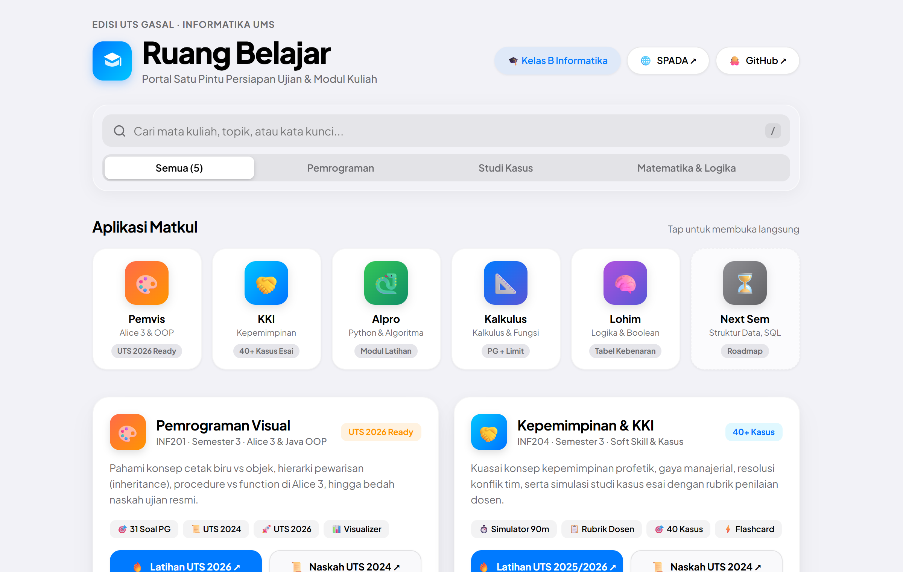

# Voltaa

**Mahasiswa Informatika · Universitas Muhammadiyah Surakarta**

Saya membuat alat belajar yang dipakai di kelas: satu halaman, tanpa akun,
tanpa build tool, nyaman dibuka dari HP.

[**Ruang Belajar →**](https://voltakyy.github.io) &nbsp;·&nbsp; [Proyek](#proyek-lain) &nbsp;·&nbsp; [Cara saya mengerjakan](#cara-saya-mengerjakan)

